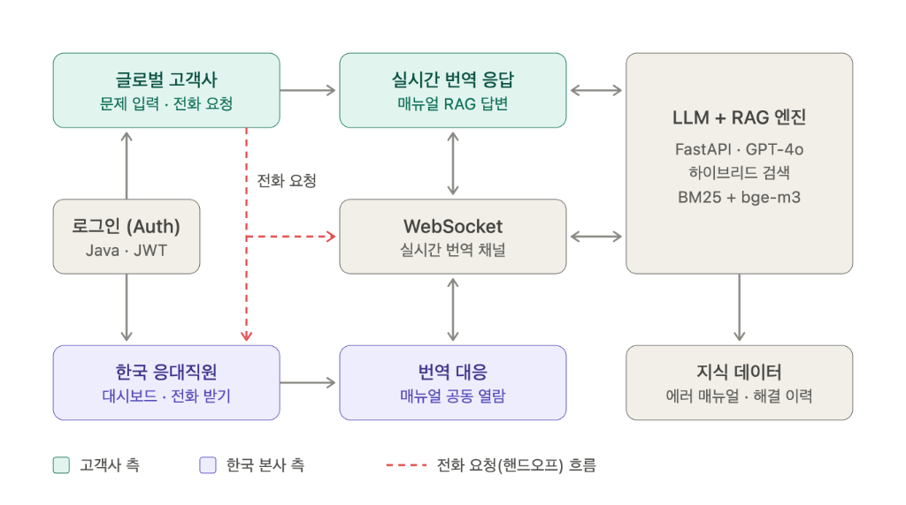
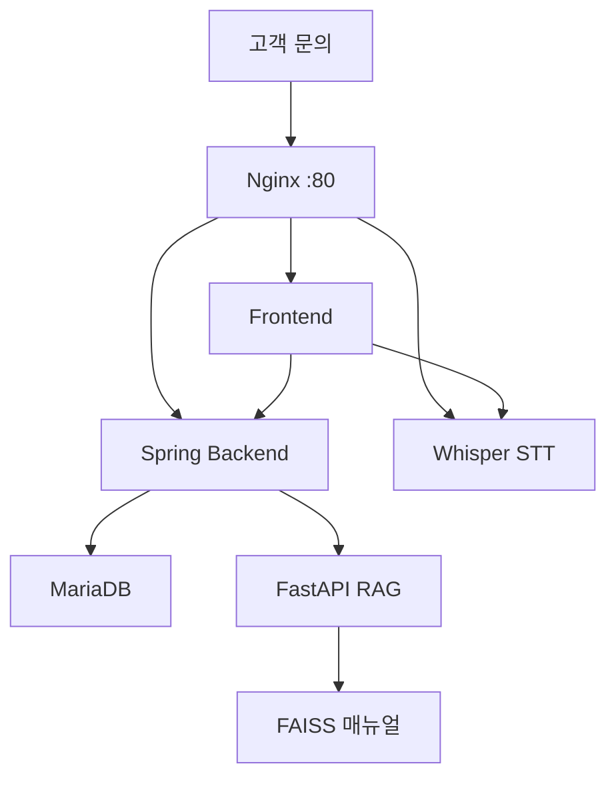

# 실시간 장비 트러블슈팅

글로벌 고객의 영어 문의와 한국 상담원의 한국어 응대를 실시간으로 잇고, 장비 매뉴얼에서 해결 방법을 찾는 시스템입니다.

## Overview

- **목적**: 장비명·에러 코드로 접수한 문의를 통화로 연결하고, 번역과 매뉴얼 검색으로 응대를 돕는다
- **방법**: Nginx 단일 진입점 아래 프론트, Spring 백엔드, Whisper 음성 변환, FAISS RAG를 붙인다

고객은 영어 화면에서 문의를 넣고, 상담원은 한국어 화면에서 통화를 받습니다. 역할은 회원가입 시 `USER`, 기동 시 만들어 두는 테스트 계정만 `ADMIN`입니다.

## Features

- 장비·에러 코드는 매뉴얼에 있는 값만 선택해 접수
- 통화 중 음성을 텍스트로 바꾼 뒤 상대 언어로 번역
- 접수한 장비·오류·증상을 FAISS에서 검색해 상담원에게 매뉴얼 근거를 표시
- 상담원 테스트 계정 `admin` / `test1234`는 백엔드 기동 시 한 번 생성

## Tech Stack

- Frontend: HTML / JavaScript, STOMP
- Backend: Spring Boot, JWT, MariaDB
- Voice: Whisper
- RAG: FastAPI, FAISS, OpenAI
- Deploy: Docker Compose, Nginx

## Architecture

고객사 화면에서 문의를 넣고 통화를 요청하면, 한국 상담원이 받아 번역 채널과 매뉴얼 검색을 같이 봅니다.




## System Architecture



## Directory Structure

```
├── frontend/       # 고객·상담원 화면
├── backend/        # 인증, 통화, 번역 요청
├── fastapi/        # 매뉴얼 RAG
├── voice/          # 음성 변환
├── rag_pipeline/   # 매뉴얼과 FAISS 인덱스 빌드
├── nginx/          # 단일 진입점
├── docker-compose.yml
├── build.sh
└── .env.example
```

## Usage

```sh
cp .env.example .env    # MYSQL_*, JWT_SECRET, OPENAI_API_KEY 입력
./build.sh              # FAISS, Gradle, npm 빌드 후 컨테이너 기동
```

브라우저에서 `http://localhost`로 접속합니다. 상담원 화면은 `admin` / `test1234`, 고객 화면은 회원가입으로 만든 계정으로 로그인합니다.
